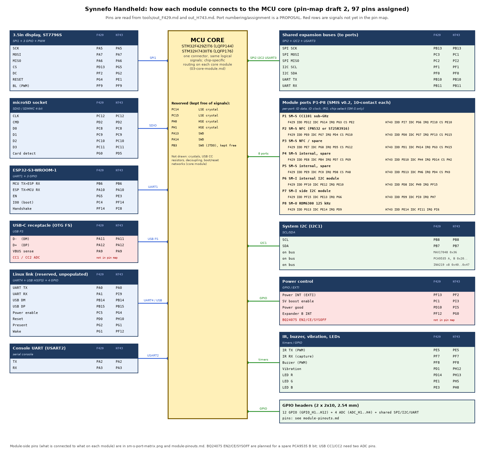
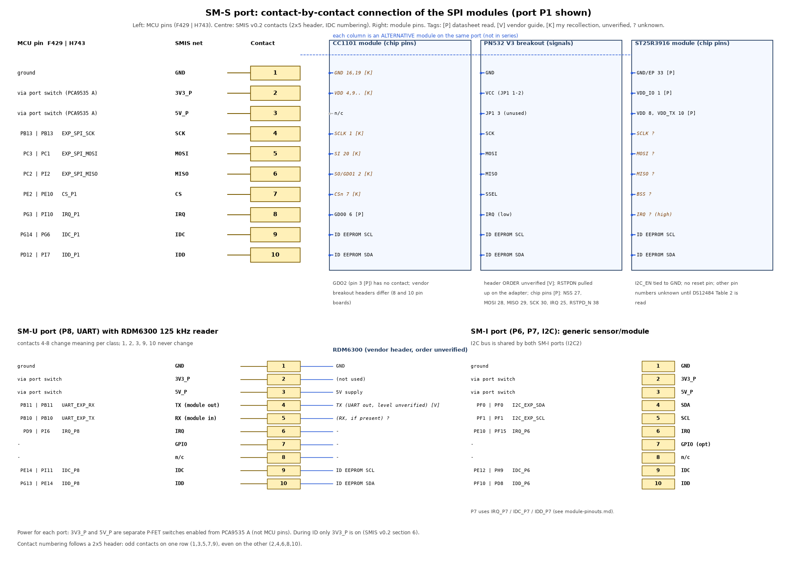

# Module pinouts and connections

Generated by `gen_pinouts.py` from the solved pin maps (`tools/out_F429.md`, `tools/out_H743.md`). Status: PROPOSED draft. MCU pins are exact for the pin-map draft 2 (97 pins assigned). Module-side pins are only as good as their tag.

Tags: **[P]** read by a research agent from a manufacturer datasheet or user manual; **[V]** vendor page or guide (secondary); **[K]** my recollection of the standard pinout, *not checked in this project*; **?** unknown. Port numbers P1 to P8 and the module-to-port assignment are a proposal for this document, not a decision.

## 1. What I know about each module's own pins

| Module | Role / where it connects | Interface | Supply | Pins known | Pins not known |
|---|---|---|---|---|---|
| **CC1101** sub-GHz module (868 / 433 MHz, Indian breakouts) | SM-S port, proposed P1 | SPI mode 0, MSB, 6.5 to 10 MHz | 1.8-3.6 V, not 5 V tolerant | chip pins [P]: GDO2 = 3, GDO0 = 6. Chip [K]: SCLK 1, SO/GDO1 2, CSn 7, SI 20 | vendor breakout header order: 8-pin boards put GDO0 on pin 3 and GDO2 on 8, 10-pin boards GDO0 on 7 and GDO2 on 8 [V, partial]; check the silkscreen of the board you buy |
| **PN532 V3** NFC breakout (Variant A) | SM-S port via the adapter, proposed P2 | SPI mode 0, LSB first, 5 MHz max, IRQ active low | breakout VCC 3.3-5 V claimed [V]; chip VBAT 2.7-5.5 V, PVDD <= 3.6 V [P] | chip pins [P]: I0 16, I1 17, NSS 27, MOSI 28, MISO 29, SCK 30, P70_IRQ 25, P32_INT0 32, RSTPD_N 38. Header signal names [V]: VCC, GND, SCK, MISO, MOSI, SSEL, IRQ, RSTPDN, plus I2C/UART shares | **header order and position**, regulator, DIP switch mapping (conflicting sources) |
| **ST25R3916** NFC module (Variant B) | SM-S port, proposed P2 or P3 | SPI mode 1, MSB, 10 MHz max, IRQ active high; no reset pin | VDD/VDD_TX 2.4-5.5 V, VDD_IO 1.65-5.5 V [P] | chip pins [P]: VDD_IO 1, VDD_D 3, VDD_A 7, VDD 8, VDD_RF 9, VDD_TX 10, VDD_AM 11, VDD_DR 14, exposed pad 33 | SCLK, MOSI, MISO, BSS, IRQ, I2C_EN, XTI, XTO and antenna pin numbers (DS12484 Table 2 not read); chip not sourceable in India yet |
| **RDM6300** 125 kHz reader | SM-U port, proposed P8 | UART 9600 baud, EM4100 only | 5 V | functions only (5 V, GND, TX; antenna coil connector) [V] | header order, TX voltage level, whether an RX pin exists |
| **Generic I2C module** | SM-I ports, proposed P6, P7 | I2C 400 kHz | 3.3 V (5 V pin available) | SMIS contacts only | per module |
| **ST7796S 3.5in display** (Waveshare module, touch unused) | on-board, SPI1 | SPI, RGB565 | 3.3 V / 5 V with on-board translator [V] | signal names [V]: VCC, GND, MISO, MOSI, SCLK, LCD_CS, LCD_DC, LCD_RST, LCD_BL, TP_SDA, TP_SCL, TP_INT, TP_RST (15-pin GH1.25 cable) | physical pin order; the cable lists 13 names for 15 pins |
| **microSD socket** | on-board, SDIO / SDMMC 4-bit | SD mode | 3.3 V | standard microSD contacts [K]: 1 DAT2, 2 CD/DAT3, 3 CMD, 4 VDD, 5 CLK, 6 VSS, 7 DAT0, 8 DAT1, plus a card-detect switch | the chosen socket's own numbering (DNA Tech TF-07F 9-pin) |
| **ESP32-S3-WROOM-1** | on-board, UART1 | UART, 3.3 V | 3.0-3.6 V, own rail >= 500 mA [P] | [P]: TXD0 = GPIO43 = pin 37, RXD0 = GPIO44 = pin 36; strapping pins GPIO0, GPIO3, GPIO45, GPIO46; EN; octal-PSRAM variants lose IO35-37 | other module pad numbers not recorded; handshake GPIO not chosen |
| **USB-C receptacle** | on-board, USB FS | USB 2.0 FS | VBUS 5 V | D+ -> PA12, D- -> PA11, VBUS sense -> PA9 (MCU side, both chips); CC1, CC2 with 5.1 kohm each | CC1/CC2 ADC pins **not in the pin map** (gap) |
| **TSOP1738** IR receiver + IR LED | on-board, timer pins | 38 kHz, active-low output | **4.5-5.5 V** [P, 2001 sheet] | [K]: pin 1 OUT, 2 GND, 3 VS (verify) | newer datasheet, 3.3 V behaviour |
| Buzzer, vibration motor, 3 LEDs, 8 buttons | on-board | GPIO / PWM / PCA9535 B | 3.3 V | MCU side only | driver parts not chosen |
| **BQ24075** charger | on-board, control by GPIO/expander | none (pin-strapped) | USB 5 V | functions [P]: ISET, ILIM, EN1, EN2, CE, TS, TMR, SYSOFF, PGOOD, CHG | VQFN-16 pin numbers not recorded; EN2/CE/SYSOFF are **not in the pin map** (planned for PCA9535 B spare bits) |
| **MAX17048** fuel gauge | I2C_SYS | I2C 0x36 | VDD = cell | functions [P]: SDA, SCL, ALRT, QSTRT, CTG | TDFN-8 numbers not recorded |
| **PCA9535** x2 | I2C_SYS | I2C 0x20-0x27 | 2.3-5.5 V | functions [P]: A0-A2, SDA, SCL, INT, P0.0-P1.7 | SOIC-24 numbers not recorded |
| **INA219** x8 | I2C_SYS, one per 5V_P port | I2C 0x40-0x4F | 3.3 V | functions only | package numbers per board |
| Linux module (future) | reserved connector | UART + USB + 4 GPIO | TBD | MCU side only | module not chosen |

## 2. MCU pins for each module (F429 / H743)

| Module / bus | Signals (F429 / H743) |
|---|---|
| 3.5in display, ST7796S (SPI1 + 3 GPIO + PWM) | DISP_SPI_SCK: PA5 / PA5 DISP_SPI_MOSI: PA7 / PA7 DISP_SPI_MISO: PA6 / PA6 DISP_CS: PD13 / PG5 DISP_DC: PF2 / PG2 DISP_RST: PG4 / PE1 DISP_BL: PF9 / PF9 |
| microSD socket (SDIO / SDMMC 4-bit) | SD_CK: PC12 / PC12 SD_CMD: PD2 / PD2 SD_D0: PC8 / PC8 SD_D1: PC9 / PC9 SD_D2: PC10 / PC10 SD_D3: PC11 / PC11 SD_CD: PG0 / PD5 |
| ESP32-S3-WROOM-1 (UART1 + 3 GPIO) | UART_ESP_TX: PB6 / PB6 UART_ESP_RX: PA10 / PA10 ESP_EN: PG5 / PE3 ESP_BOOT: PC4 / PF14 ESP_HS: PF14 / PI8 |
| USB-C receptacle (OTG FS) (USB FS) | USB_FS_DM: PA11 / PA11 USB_FS_DP: PA12 / PA12 USB_VBUS: PA9 / PA9 |
| Linux link (reserved, unpopulated) (UART4 + USB HS(FS) + 4 GPIO) | UART_LINUX_TX: PA0 / PA0 UART_LINUX_RX: PA1 / PI9 LINUX_USB_DM: PB14 / PB14 LINUX_USB_DP: PB15 / PB15 LINUX_EN: PC5 / PG4 LINUX_RST: PD0 / PH10 LINUX_PRSNT: PG2 / PG1 LINUX_WAKE: PG1 / PF12 |
| Console UART (USART2) (serial console) | UART_CON_TX: PA2 / PA2 UART_CON_RX: PA3 / PA3 |
| Shared expansion buses (to ports) (SPI2 + I2C2 + USART3) | EXP_SPI_SCK: PB13 / PB13 EXP_SPI_MOSI: PC3 / PC1 EXP_SPI_MISO: PC2 / PI2 I2C_EXP_SCL: PF1 / PF1 I2C_EXP_SDA: PF0 / PF0 UART_EXP_TX: PB10 / PB10 UART_EXP_RX: PB11 / PB11 |
| System I2C (I2C1) (SCL/SDA) | I2C_SYS_SCL: PB8 / PB8 I2C_SYS_SDA: PB7 / PB7 |
| Power control (GPIO / EXTI) | PWR_INT: PF13 / PF2 BOOST_EN: PC1 / PI3 PWR_PG: PD10 / PI5 INT_B: PF12 / PG0 |
| IR, buzzer, vibration, LEDs (timers / GPIO) | IR_TX: PE5 / PE5 IR_RX: PF7 / PF7 BUZZER: PF8 / PF8 VIBRATION: PD1 / PH12 LED_R: PD14 / PH13 LED_G: PE1 / PH5 LED_B: PE3 / PH8 |

### Ports P1 to P8

| Port | Class | Proposed module | F429 pins | H743 pins |
|---|---|---|---|---|
| P1 | SM-S | CC1101 sub-GHz | IDD PD12 IDC PG14 IRQ PG3 CS PE2 | IDD PI7 IDC PG6 IRQ PI10 CS PE10 |
| P2 | SM-S | NFC (PN532 or ST25R3916) | IDD PE0 IDC PG7 IRQ PD4 CS PG10 | IDD PD0 IDC PG7 IRQ PF13 CS PG15 |
| P3 | SM-S | NFC / spare | IDD PE7 IDC PG8 IRQ PD5 CS PG12 | IDD PD1 IDC PH14 IRQ PG3 CS PH15 |
| P4 | SM-S | internal, spare | IDD PE8 IDC PB4 IRQ PD7 CS PG9 | IDD PD10 IDC PH4 IRQ PD14 CS PH2 |
| P5 | SM-S | internal, spare | IDD PE9 IDC PC0 IRQ PD8 CS PA8 | IDD PD13 IDC PH6 IRQ PD4 CS PH3 |
| P6 | SM-I | internal I2C module | IDD PF10 IDC PE12 IRQ PE10 | IDD PD8 IDC PH9 IRQ PF15 |
| P7 | SM-I | side I2C module | IDD PF15 IDC PE13 IRQ PG6 | IDD PD9 IDC PI0 IRQ PH7 |
| P8 | SM-U | RDM6300 125 kHz | IDD PG13 IDC PE14 IRQ PD9 | IDD PE14 IDC PI11 IRQ PI6 |

### GPIO headers

| Signal | F429 | H743 |
|---|---|---|
| GPIO_H1 | PD11 | PI4 |
| GPIO_H2 | PD15 | PD3 |
| GPIO_H3 | PD3 | PD7 |
| GPIO_H4 | PE4 | PE0 |
| GPIO_H5 | PF11 | PE12 |
| GPIO_H6 | PG15 | PE13 |
| GPIO_H7 | PC6 | PE7 |
| GPIO_H8 | PC7 | PF10 |
| GPIO_H9 | PD6 | PF11 |
| GPIO_H10 | PE15 | PG10 |
| GPIO_H11 | PE6 | PG14 |
| GPIO_H12 | PG11 | PG8 |
| ADC_H1 | PF3 | PF3 |
| ADC_H2 | PF4 | PF4 |
| ADC_H3 | PF5 | PF5 |
| ADC_H4 | PF6 | PF6 |

### Reserved pins

| F429 | H743 |
|---|---|
| PC14 (LSE crystal) | PC14 (LSE crystal) |
| PC15 (LSE crystal) | PC15 (LSE crystal) |
| PH0 (HSE crystal) | PH0 (HSE crystal) |
| PH1 (HSE crystal) | PH1 (HSE crystal) |
| PA13 (SWD) | PA13 (SWD) |
| PA14 (SWD) | PA14 (SWD) |
| PB3 (SWO (JTDO), kept free for trace) | PB3 (SWO (JTDO), kept free for trace) |

## 3. SM-S port contact-by-contact

| Contact | SMIS net | CC1101 module | PN532 breakout | ST25R3916 module |
|---|---|---|---|---|
| 1 | GND | GND 16,19 [K] | GND | GND/EP 33 [P] |
| 2 | 3V3_P | VDD 4,9.. [K] | VCC (JP1 1-2) | VDD_IO 1 [P] |
| 3 | 5V_P | n/c | JP1 3 (unused) | VDD 8, VDD_TX 10 [P] |
| 4 | SCK | SCLK 1 [K] | SCK | SCLK ?  |
| 5 | MOSI | SI 20 [K] | MOSI | MOSI ? |
| 6 | MISO | SO/GDO1 2 [K] | MISO | MISO ? |
| 7 | CS | CSn 7 [K] | SSEL | BSS ? |
| 8 | IRQ | GDO0 6 [P] | IRQ (low) | IRQ ? (high) |
| 9 | IDC | ID EEPROM SCL | ID EEPROM SCL | ID EEPROM SCL |
| 10 | IDD | ID EEPROM SDA | ID EEPROM SDA | ID EEPROM SDA |

## 4. Gaps found while building these diagrams

1. **USB-C CC1 / CC2 ADC inputs** (needed to read the source's advertised current, `09-power-architecture.md` §2) are not in the pin maps. Two ADC pins must be added and the maps re-solved.
2. **BQ24075 control lines (EN2, CE, SYSOFF)** have no MCU pins; the plan is spare bits on PCA9535 B (8 of its 16 bits are unused).
3. **Port numbering and module assignment** (P1 to P8) were never fixed in the SMIS documents; this table proposes one.
4. **ESP32 handshake GPIO**, **vibration/buzzer drivers** and **IR LED driver** are MCU-side only; the module-side parts are not chosen.
5. Vendor breakout headers (PN532 V3, CC1101 boards, RDM6300) must be measured on the actual boards before any adapter is routed.
